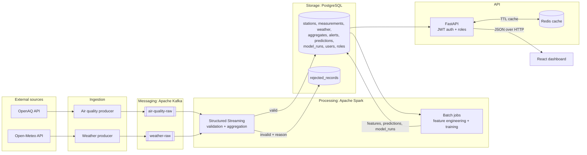
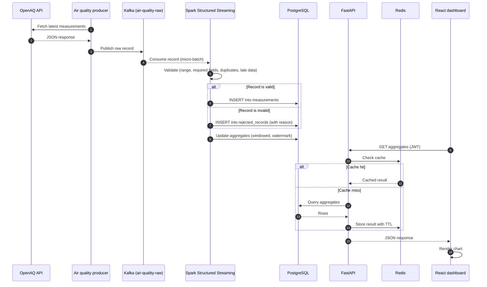

# Architecture

AirQuality KS collects air quality and weather data for Kosovo, validates and aggregates it, forecasts PM2.5 and shows the results on a web dashboard. The reasoning behind each technology choice is in [adr.md](adr.md).

## Layers

| Layer | What it does | Technology |
| --- | --- | --- |
| Ingestion | Python producers fetch data from OpenAQ (air quality) and Open-Meteo (weather) and publish raw JSON records. | Python producers (`ingestion/`) |
| Messaging | Buffers raw records and decouples producers from processing. Topics: `air-quality-raw`, `weather-raw`. | Apache Kafka 4.4.0 (KRaft) |
| Processing | Structured Streaming validates records and computes windowed aggregates. Batch jobs do feature engineering and prepare training data. | Apache Spark / PySpark 4.2.1 (`processing/`) |
| Storage | Stores stations, measurements, weather, aggregates, alerts, predictions, model runs, rejected records, users and roles. | PostgreSQL 18.6, Alembic 1.20.1 (`db/`) |
| ML | Trains and evaluates PM2.5 forecasting models and writes predictions. | XGBoost, linear regression baseline (`ml/`) |
| API | REST endpoints with JWT auth and roles. Caches expensive reads. | FastAPI 0.162.0, Redis 8.8.4 (`api/`) |
| Presentation | Maps, charts, filters and alerts for users. | React 19.3.1, TypeScript 7.0.2, Vite 8.3.5 (`dashboard/`) |

## Component diagram

## Data flow for one measurement

## Components and owners

| Component | Responsibility | Technology | Owner |
| --- | --- | --- | --- |
| Measurements | OpenAQ producer, `air-quality-raw` topic, streaming validation, `measurements` and `rejected_records` tables | Python, Kafka, PySpark, PostgreSQL | Shqiprimi |
| Weather and aggregates | Open-Meteo producer, `weather-raw` topic, `weather` table, windowed aggregates | Python, Kafka, PySpark, PostgreSQL | Rona |
| ML forecasting | EDA, feature engineering (Spark batch), model training and evaluation, `predictions` and `model_runs` | PySpark, XGBoost, scikit-learn | Besarta |
| Infrastructure | Docker Compose, local Kubernetes, CI, migrations, API shell, Redis cache | Docker, minikube/kind, GitHub Actions, Alembic, FastAPI | Besarta + Shqiprimi |

## Data model (overview)

The planned tables are listed below. The final schema, including columns, keys and constraints, is defined in the ERD by Shqiprimi ([erd.md](erd.md)).

| Table | Contents |
| --- | --- |
| `stations` | Monitoring stations and their location (city, coordinates) |
| `measurements` | Validated pollutant readings per station and timestamp |
| `weather` | Hourly weather observations per location |
| `aggregates` | Hourly/daily statistics per station and pollutant |
| `alerts` | Threshold breaches (for example, PM2.5 above a limit) |
| `predictions` | Forecast PM2.5 values per station and target time |
| `model_runs` | Training runs: model type, parameters, metrics (MAE, RMSE) |
| `rejected_records` | Raw records that failed validation, with the rejection reason |
| `users` | Dashboard and API users |
| `roles` | Admin, Analyst, Public |

## Environments

- **Development:** Docker Compose (`make up`). See the [README](../README.md#setup).
- **Production-like:** local Kubernetes (minikube or kind) with manifests in `deploy/`. The system is not publicly hosted.
- **CI:** GitHub Actions runs on pull requests to `dev` and `main`.
